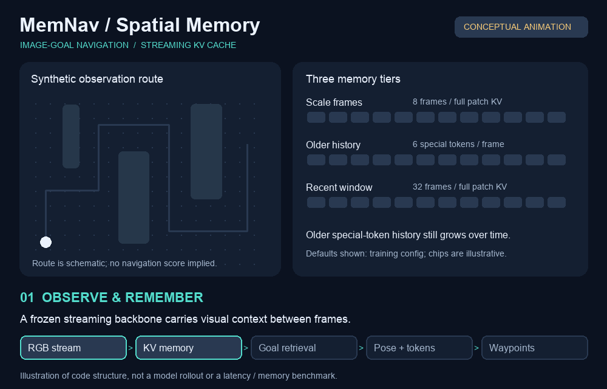

# MemNav · Spatial Memory for Navigation

**面向图像目标导航的空间记忆研究：流式 KV cache、历史检索与扩散轨迹规划。**

How can a robot use a place it saw earlier to navigate toward a goal image? This research workspace connects a frozen **LingBot-Map** streaming visual backbone with goal retrieval, geometric pose reasoning and a diffusion navigation policy. It brings together the `InternNav` training pipeline, `MemNavData` episode generation and the `NavDP` evaluation framework.

This is a portfolio and development fork of [glbreeze/Nav](https://github.com/glbreeze/Nav). The shared research implementation and upstream models retain their original attribution; individual changes are identified below.



*Conceptual animation generated for this README using a synthetic route. It illustrates the code structure, not a trained-policy rollout, measured speedup or successful navigation trial. [Rendering source](scripts/render_memory_demo.py).*

## What the project contains

| Component | Implementation | Engineering focus |
| --- | --- | --- |
| Streaming visual memory | Frozen LingBot-Map front-end with scale-frame, historical-special-token and recent-window KV storage | Stateful attention, temporal indexing and cache reuse |
| Goal retrieval | DINO descriptors, candidate masks, ranking and revisit/novel gating | Matching a target view against observation history |
| Geometric conditioning | Cached current pose, warm goal replay and relative-pose readout | Coordinate conventions and geometry-aware model interfaces |
| Trajectory prediction | Trainable heads and a diffusion decoder; configured prediction horizon of 24 waypoints | Combining learned visual and geometric representations |
| Data and training | Multi-leg episodes, precomputed features, batch processing and checkpointed training | Reproducible research pipelines |
| Evaluation and diagnosis | NavDP benchmark scripts, pose/cache diagnostics and unit tests | Separating representation errors from policy failures |

## How KV cache is used

Here, KV cache holds **visual attention state across observation frames**. The training configuration currently uses 8 scale frames and a 32-frame recent window. Older frames retain 6 special tokens per frame: camera, four register tokens and scale. See [the streaming wrapper](InternNav/internnav/model/basemodel/memnav/lingbot_stream.py) and [training defaults](InternNav/scripts/train/configs/memnav.py).

1. Precompute streaming features and cache state for the trajectory.
2. Reuse scale/history KV and replay the local image window for current visual and geometric features.
3. Match the goal image against candidate history descriptors. Training can teacher-force the anchor; inference uses the retrieval prediction.
4. Warm-replay context near the selected anchor (default depth: 64 frames), append the goal image, and estimate its pose in the remembered context.
5. Combine current features, the relative pose and visual tokens to condition trajectory prediction.

The full-patch window is bounded, but historical special-token storage grows with trajectory length. Cache reuse does not by itself establish constant memory use or a measured inference speedup. These are design choices to profile, not performance claims.

## My traceable changes

The fork includes a dedicated [`fix/rotation-frame-conjugation` branch](https://github.com/yf2685-beep/memnav-spatial-memory/tree/fix/rotation-frame-conjugation) with commits under `yf2685-beep`:

- [Action-label coordinate correction](https://github.com/yf2685-beep/memnav-spatial-memory/commit/0e9606d): adjusts the MemNav loader's rotation convention so forward motion is retained in the planar action labels, with a legacy-mode switch for comparisons.
- [Environment and short-run support](https://github.com/yf2685-beep/memnav-spatial-memory/commit/c2e004d): makes the Open3D import optional and adds trajectory/step limits for diagnostic training runs.

These changes demonstrate data-label diagnosis, coordinate-frame reasoning and research-environment debugging. They are on that branch; the current `main` branch has a separate upstream pose-convention fix and should not be described as containing a merge of this branch. The shared KV-cache architecture is credited to the research project, not claimed here as an individual implementation.

## Reading guide

| Start here | Purpose |
| --- | --- |
| [MemNav policy](InternNav/internnav/model/basemodel/memnav/memnav_policy.py) | Retrieval, current/goal pose handling and trainable conditioning |
| [LingBot stream](InternNav/internnav/model/basemodel/memnav/lingbot_stream.py) | KV injection, window replay and warm goal append |
| [Dataset guide](InternNav/internnav/dataset/README_memnav_dataset.md) | Episode layout, sampling and cache inputs |
| [Episode generator](MemNavData/README.md) | Multi-stop image-goal data generation |
| [Pose diagnostics](InternNav/internnav/model/basemodel/memnav/README.md) | Recorded investigations and limitations; some notes describe earlier revisions |
| [Benchmark design](multistop_benchmark_design.md) | Seen/unseen goals and multi-stop evaluation protocol |
| [Existing evaluation notes](evaluation.md) | Recorded NavDP/LoGoPlanner baseline results, not a MemNav performance claim |

## Getting started

```bash
git clone https://github.com/yf2685-beep/memnav-spatial-memory.git
cd memnav-spatial-memory
```

**Recreate the README animation on a CPU:**

```bash
python -m venv .venv-demo
source .venv-demo/bin/activate
python -m pip install 'Pillow>=10.1'
python scripts/render_memory_demo.py
```

**Research training requires a separate GPU environment.** Follow the [InternNav setup guide](InternNav/README.md) and prepare the data described in [MemNavData](MemNavData/README.md). LingBot-Map source, model weights, trajectory images and precomputed caches are external prerequisites. Configure the actual locations instead of using the original developer's machine paths:

```bash
export LINGBOT_REPO=/absolute/path/to/lingbot-map
export LINGBOT_WEIGHTS=/absolute/path/to/lingbot-map-long.pt
export MEMNAV_ROOT_DIR=/absolute/path/to/trajectory-data
export MEMNAV_FEATURE_ROOT=/absolute/path/to/precomputed-features
export MEMNAV_WINDOW=32
export MEMNAV_NUM_SCALE=8
export MEMNAV_MAX_FRAME_NUM=2048
```

These cache dimensions must match precomputation. After installing the research dependencies and configuring the dataset, the training entry point is:

```bash
cd InternNav
python scripts/train/train.py --model-name memnav --name memnav_experiment
```

For simulation, follow the separate [NavDP environment instructions](NavDP/README.md). The checked-in MemNav inference directory currently contains backbone/network components but does **not** include the `memnav_server.py` and `policy_agent.py` mentioned in its older README. A complete MemNav HTTP serving path therefore requires additional integration; the root README does not promise a one-command end-to-end rollout.

## Validation and attribution

The portfolio update checks the animation, documentation links and existing lightweight pose-convention tests. It does not rerun GPU training or IsaacSim evaluation. Existing experiment notes remain attributed to their original runs; no new navigation success-rate or KV-cache speedup is claimed.

Research and upstream foundations: [glbreeze/Nav](https://github.com/glbreeze/Nav), [LingBot-Map](https://github.com/Robbyant/lingbot-map), [InternNav](https://github.com/InternRobotics/InternNav) and [NavDP](https://github.com/InternRobotics/NavDP). Consult each component's license, model terms and dataset terms. This overview does not add or replace a repository-wide license.
